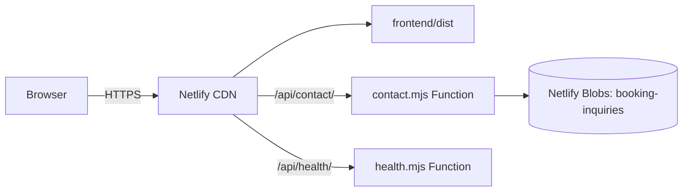

# Netlify deployment guide

This project deploys to Netlify as a static React/Vite site plus a Netlify Function that handles booking inquiries. No database server or secrets are required in production.



The site deploys from the repository's `main` branch. Netlify reads `netlify.toml` from the repository root.

## What `netlify.toml` does

1. Installs and builds the frontend: `npm --prefix frontend ci && npm --prefix frontend run build`.
2. Sets `VITE_BASE=/` so assets load from the site root (the Django build uses `/static/`).
3. Sets `VITE_API_URL=/api` so the booking form calls the same-origin function, even if a local `frontend/.env` exists.
4. Publishes `frontend/dist`.
5. Redirects legacy `/static/*` URLs (such as the Open Graph image) to the root with a 301.
6. Falls back to `index.html` for client-side routes like `/projects` and `/booking`.
7. Caches hashed files under `/assets/` for one year.

The root `package.json` declares `@netlify/blobs`, which Netlify installs automatically and bundles into the functions in `netlify/functions/`.

## Booking API

`netlify/functions/contact.mjs` mirrors the Django `contact_inquiry` view:

| Case | Response |
| --- | --- |
| Valid inquiry | `201` with `status`, `message`, `id`, and `inquiry`; stored in the `booking-inquiries` Blobs store |
| Missing name, invalid email, or a field over its length limit | `400` with field `errors` |
| Hidden `website` honeypot filled | `201`, nothing stored |
| More than 5 requests per minute from one IP | `429` (Netlify rate limiting) |

Stored inquiries can be browsed in the Netlify UI under **Blobs**, or with the CLI:

```bash
npx netlify-cli blobs:list booking-inquiries
```

## Custom domain

The DNS for `jonasjavier.dev` is managed at name.com. To serve the site at `izaksphotos.jonasjavier.dev`:

1. In Netlify, open **Domain management → Add a domain** and enter `izaksphotos.jonasjavier.dev`.
2. At name.com, set the `izaksphotos` CNAME record to `izaksphotos.netlify.app`.
3. Wait for DNS to propagate; Netlify issues the HTTPS certificate automatically.

## Pre-deploy checklist

Run the same critical checks locally before merging to `main`:

```powershell
$env:DJANGO_SECRET_KEY = "local-test-only-0123456789abcdefghijklmnopqrstuvwxyz-ABCDEFG"
$env:DJANGO_DEBUG = "false"
python backend/manage.py test api
npm ci --prefix frontend
npm --prefix frontend run build
```

Confirm that:

- The working tree contains no secrets or local database files.
- Import paths match file-name casing exactly; Netlify builds on Linux.
- Changes to the booking contract are made in both `backend/api/` and `netlify/functions/contact.mjs`.
- The production build loads `/`, `/projects`, `/booking`, and `/about` directly.
- The GitHub Actions workflow is green.

## Production verification

After Netlify reports a successful deploy, verify both the UI and the API:

```powershell
Invoke-WebRequest https://izaksphotos.netlify.app/ -UseBasicParsing
Invoke-RestMethod https://izaksphotos.netlify.app/api/health/
```

Then check the browser at desktop and mobile widths, including a direct gallery URL and the booking form's client-side validation. Do not submit real personal information to this demonstration project.

## Troubleshooting

### Vite reports `UNRESOLVED_IMPORT`

Check capitalization first. Windows resolves `Footer` and `footer` as the same path, but Netlify's Linux builder does not. Rename the file and import so their casing is identical, commit the rename, and run the frontend build again.

### Assets return 404 or the page is blank

Confirm that the built `index.html` references `/assets/...`, not `/static/assets/...`. If it does not, `VITE_BASE` was not applied; check the `[build.environment]` block in `netlify.toml`.

### The booking form reports a network error

Open `/api/health/` on the deployed site. If it does not return JSON, check the **Functions** tab and the deploy log to confirm `contact` and `health` were bundled.

### Deploys are skipped

A deploy marked "Skipped due to account credit usage exceeded" means the Netlify team has used its plan's credits. Wait for the credit reset or change plans; the code is not at fault.

## Rollback

If a new deploy misbehaves, open **Deploys** in Netlify, select the last known-good deploy, and choose **Publish deploy**. Fix the issue in a new commit; do not edit generated build artifacts or commit credentials as an emergency workaround.
